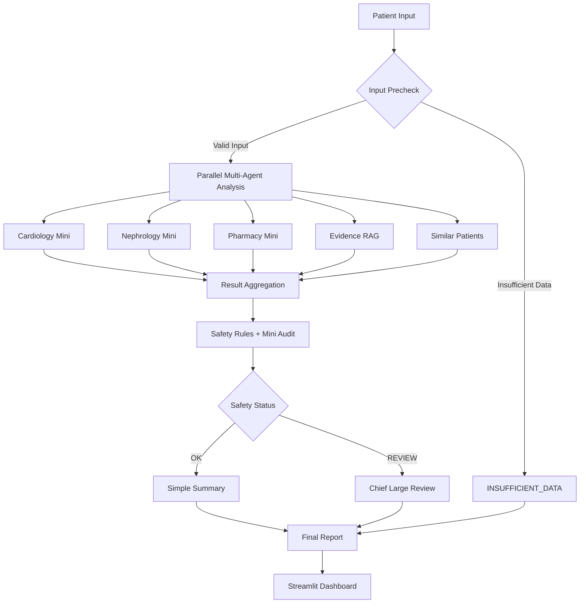
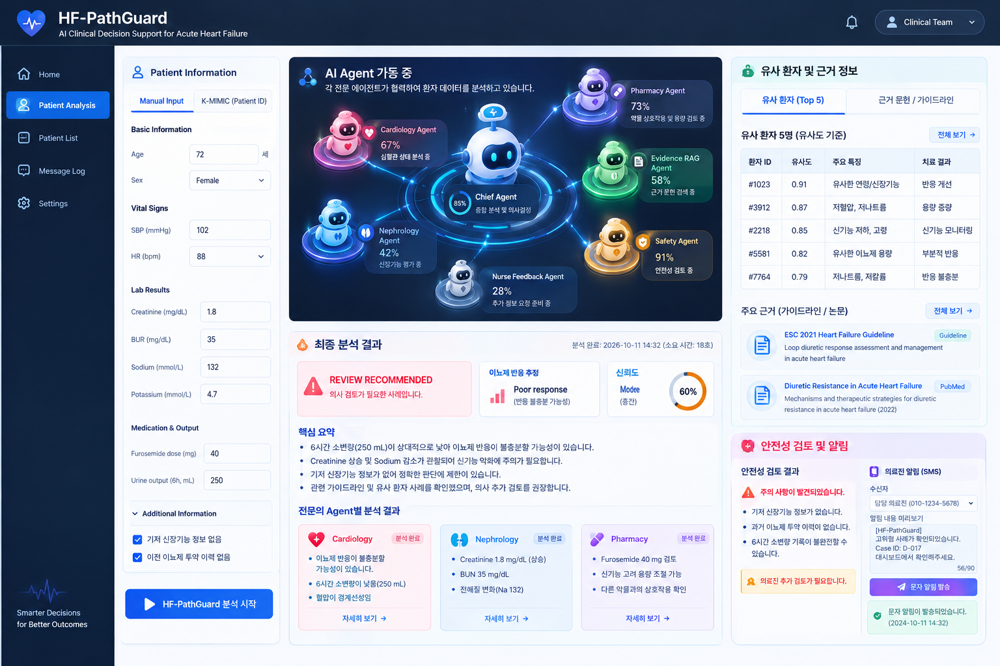

# HF-PathGuard 🫀🤖

### Safety-Aware Multi-Agent Clinical Decision Support for Acute Heart Failure

HF-PathGuard is a **LangGraph-based multi-agent clinical decision support prototype** designed for acute heart failure (AHF).

The system integrates specialized clinical AI agents, retrieval-augmented generation (RAG), similar-patient analysis, and safety-aware LLM routing to enable transparent, reliable, and token-efficient clinical review.

> **Hackathon MVP:** Developed using synthetic patient data for research and demonstration purposes. Not intended for autonomous clinical diagnosis or treatment.

---

## 1. System Architecture



## 2. Key Features

| Feature | Description |
|---|---|
| **Multi-Agent Collaboration** | Parallel cardiology, nephrology, and pharmacy Mini agents |
| **Evidence-Based RAG** | Retrieves relevant clinical evidence and supporting sources |
| **Similar-Patient Retrieval** | Identifies comparable patient records through a modular retrieval interface |
| **Safety Guardrails** | Combines deterministic safety rules with a Mini safety audit |
| **Adaptive Mini/Chief Routing** | Escalates cases requiring review to Chief Large, skipping unnecessary Chief calls |
| **Token-Efficient Design** | Avoids model calls when essential inputs are insufficient |
| **Batch Evaluation** | Evaluates up to 30 patients sequentially, tracking routing, latency, and token usage |

## 3. Installation

```bash
git clone https://github.com/syselina/medagent-basics.git
cd medagent-basics

uv sync
uv run pytest -q
uv run streamlit run app.py
```

The default `mock` mode runs locally without API keys or network access.

To configure external LLM or RAG services, copy `.env.example` to `.env` and provide the required settings.

## 4. Project Structure

```text
hf-pathguard/
├── app.py
├── agents/
│   ├── graph.py
│   ├── state.py
│   └── safety.py
├── config/
│   └── settings.py
├── data/
│   ├── schemas.py
│   ├── loader.py
│   └── sample_patients.csv
├── llm/
│   └── factory.py
├── rag/
│   └── adapter.py
├── similarity/
│   ├── adapter.py
│   └── mock_retriever.py
├── tools/
│   ├── clinical_tools.py
│   └── integration_tools.py
├── evaluation/
│   ├── baseline.py
│   ├── batch_runner.py
│   ├── demo_cases.py
│   └── metrics.py
├── services/
│   └── pipeline.py
├── ui/
│   ├── styles.py
│   └── assets/
│       └── dashboard_reference.png
├── tests/
│   ├── test_pipeline.py
│   ├── test_batch.py
│   ├── test_data.py
│   ├── test_rag.py
│   └── test_similarity.py
├── docs/
│   ├── STUDY_ORDER.md
│   └── integration.md
├── pyproject.toml
├── uv.lock
└── .env.example
```

## 5. Dashboard Preview



*Streamlit dashboard for multi-agent clinical review, evidence retrieval, safety assessment, and batch evaluation.*

## 6. Contact

**Seoyoung Park**

Email: [psy091222222@gmail.com](mailto:psy091222222@gmail.com)

GitHub: [@syselina](https://github.com/syselina)

---

**HF-PathGuard** · LangGraph · Multi-Agent AI · RAG · Clinical AI · Safety-Aware Routing