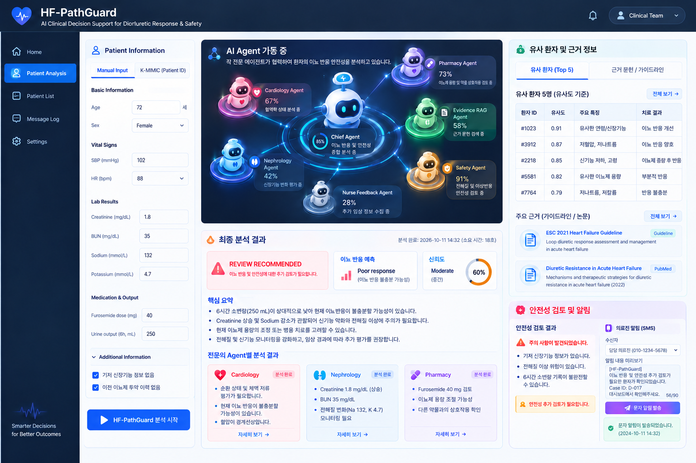

# HF-PathGuard 🫀🤖

**Safety-Aware Multi-Agent Clinical Decision Support for Acute Heart Failure**

HF-PathGuard is an Agentic AI-based clinical decision support prototype developed for the Korea Clinical Datathon 2026.

The system evaluates early diuretic response and renal/electrolyte safety in patients with acute heart failure by integrating multiple specialist agents, clinical evidence retrieval, and safety validation.

> **Current Status:** v0.1 Prototype | Under Development

---

## Target Interface



The dashboard illustrates the target interface, including multi-agent clinical analysis, similar patient retrieval, evidence-based recommendations, and safety alerts.

*Some features shown are planned and not yet implemented.*

---

## Why HF-PathGuard?

Large language models can generate clinically plausible explanations but may:

- Misinterpret clinical measurements
- Produce inconsistent assessments across specialties
- Generate unsupported recommendations
- Overlook missing information or safety concerns

HF-PathGuard aims to address these limitations by combining **multi-agent clinical reasoning, evidence retrieval, and deterministic safety validation**, while keeping healthcare professionals involved in final decisions.

---

## Architecture

```text
                  Patient Data
                       |
                       v
                 Multi-Agent AI
                       |
         +-------------+-------------+
         |             |             |
         v             v             v
     Cardiology    Nephrology     Pharmacy
        Agent         Agent        Agent
         |             |             |
         +-------------+-------------+
                       |
                       v
                Safety Validation
                       |
                       v
                  Final Report
                       |
                       v
               Clinical Review
```

**Planned Extensions**

- Chief Agent orchestration
- Evidence RAG and similar patient retrieval
- Interactive clinical dashboard
- Configurable LLM integration
- Single LLM vs. Multi-Agent evaluation
- Clinician notification workflow

---

## Version Roadmap

| Version | Key Features | Status |
|---|---|---|
| **v0.1** | Initial Multi-Agent Prototype & Safety Validation | ✅ Completed |
| **v0.2** | Chief Agent, Specialist Agents & Tool Integration | 🔜 Planned |
| **v0.3** | Evidence RAG & Similar Patient Retrieval | Planned |
| **v0.4** | Streamlit Dashboard, Patient Data Integration & LLM Switching | Planned |
| **v0.5** | Single LLM vs. Multi-Agent Evaluation, Safety Assessment & Clinical Alerts | Planned |
| **v1.0** | Fully Integrated HF-PathGuard Demo | Target |

---

## Project Structure

```text
KMIMIC-multi-agents/
│
├── agents/
├── assets/
├── config/
├── data/
├── docs/
├── evaluation/
├── llm/
├── rag/
├── services/
├── similarity/
├── tests/
├── tools/
├── ui/
│
├── app.py
├── hf-agents_v01.ipynb
├── requirements.txt
├── .env.example
├── .gitignore
└── README.md
```

---

## Development

**Current Prototype:** `hf-agents_v01.ipynb`

**Tech Stack:** Python · LangGraph · LLM APIs · Streamlit

HF-PathGuard is a research prototype intended to support, not replace, clinical judgment.